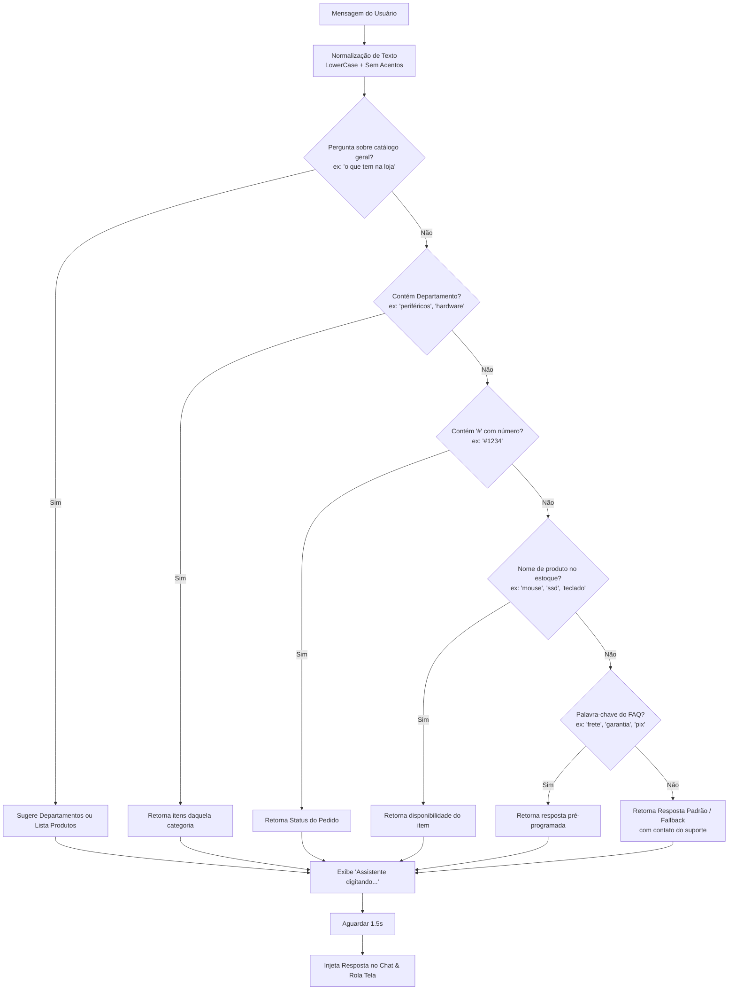

# 🤖 Chatbot de FAQ para Atendimento Virtual

> Assistente virtual responsivo, leve e 100% executado no navegador (Client-Side), desenvolvido com HTML5, CSS3 moderno e Vanilla JavaScript.

[](https://developer.mozilla.org/pt-BR/docs/Web/HTML)
[](https://developer.mozilla.org/pt-BR/docs/Web/CSS)
[](https://developer.mozilla.org/pt-BR/docs/Web/JavaScript)
[](https://phbrandes.github.io/chat-bot-de-atendimento-faq/)

---

### 🌐 Demonstração ao Vivo
> 🔗 **Experimente o projeto em tempo real:**  
> **[👉 Clique aqui para testar o Atendimento Virtual no GitHub Pages](https://phbrandes.github.io/chat-bot-de-atendimento-faq/)**

---

## 📋 Sumário
- [Sobre o Projeto](#-sobre-o-projeto)
- [Impacto de Negócio & Casos de Uso](#-impacto-de-negócio--casos-de-uso)
- [Competências Demonstradas (Recruiter Highlights)](#-competências-demonstradas-recruiter-highlights)
- [Funcionalidades Principais](#-funcionalidades-principais)
- [Como Funciona o Sistema](#-como-funciona-o-sistema)
  - [Fluxo de Tomada de Decisão (Árvore de Resolução)](#fluxo-de-tomada-de-decisão-árvore-de-resolução)
  - [Tratamento e Normalização de Texto](#tratamento-e-normalização-de-texto)
- [Estrutura dos Arquivos](#-estrutura-dos-arquivos)
- [Como Executar Localmente](#-como-executar-localmente)
- [Como Hospedar no GitHub Pages](#-como-hospedar-no-github-pages)
- [Guia de Customização](#-guia-de-customização)
- [Exemplos de Perguntas Suportadas](#-exemplos-de-perguntas-suportadas)
- [Tecnologias Utilizadas](#-tecnologias-utilizadas)
- [Roadmap de Evolução](#-roadmap-de-evolução)
- [Autor & Contato](#-autor--contato)
- [Licença](#-licença)

---

## 💡 Sobre o Projeto

O **Chatbot de Atendimento FAQ** é uma solução para **automação de atendimento de primeiro nível (N1)** em e-commerces e empresas de serviços. 

O objetivo central é diminuir a sobrecarga dos atendentes humanos respondendo em milissegundos às dúvidas mais frequentes de clientes sobre:
- 🚚 **Logística & Prazos**: Informações de frete médio, prazos regionais e rastreio.
- 📦 **Consulta de Pedido**: Simulação dinâmica de status de entrega via código de pedido com hashtag (ex: `#1234`).
- 🛍️ **Consulta de Estoque**: Verificação instantânea de disponibilidade por item ou categoria.
- 💳 **Políticas Financeiras & Cupons**: Formas de pagamento, descontos no PIX e cupons promocionais.
- 🛡️ **Pós-Venda & Garantia**: Política de devolução e prazo legal de garantia.
- 👨‍💻 **Transbordo Humano**: Encaminhamento assistido para atendentes via WhatsApp.

O projeto opera **100% no lado do cliente (Client-Side)**, eliminando custos de hospedagem de backend ou banco de dados para pequenos negócios.

---

## 💼 Impacto de Negócio & Casos de Uso

| Problema Comum em E-commerces | Solução Implementada pelo Bot |
| :--- | :--- |
| **Fila de espera para dúvidas repetitivas** | Respostas automáticas instantâneas 24 horas por dia, 7 dias por semana. |
| **Custo de infraestrutura para bots complexos** | Execução 100% estática sem necessidade de servidores pagos, APIs caras ou bancos de dados. |
| **Dificuldade de navegação em catálogos grandes** | Menu interativo com botões rápidos (*Quick Replies*) e busca por departamentos. |
| **Clientes confusos sobre status de entrega** | Detecção inteligente de número de pedido (`#XXXX`) para feedback rápido. |
| **Frustração quando o bot não sabe a resposta** | Transbordo transparente com dados de contato direto da equipe humana. |

---

## 🎯 Competências Demonstradas (Recruiter Highlights)

Para recrutadores e gestores técnicos, este projeto demonstra proficiência prática em:

- **Domínio de Vanilla JavaScript (ES6+)**:
  - Manipulação avançada do DOM sem frameworks pesados.
  - Controle de fluxo assíncrono com `setTimeout` para emulação de latência humana (*typing effect*).
  - Normalização de strings via decomposição Unicode (`NFD`) e Regex Unicode Property Escapes (`\p{Diacritic}`).
  - Algoritmo de mapeamento de intenções baseado em dicionários de dados.
- **Arquitetura Orientada a Dados (Data-Driven)**:
  - Separação clara entre a lógica de execução e a base de conhecimento (`baseDeConhecimento`, `estoqueProdutos`, `departamentos`), permitindo que o catálogo seja expandido sem alterar o código-fonte da aplicação.
- **Design de Interface Moderno (UI/UX)**:
  - Implementação de **Glassmorphism** com `backdrop-filter: blur()`, sombras multicamadas e transparências HSL/RGBA.
  - Formato ergonômico em cápsula para inputs e botões responsivos com estados `:hover` e micro-animações de escala.
- **Engenharia de Software Pragmática**:
  - Código limpo, autodocumentado, portável e pronto para produção em servidores estáticos.

---

## ✨ Funcionalidades Principais

- **Design Glassmorphism Premium**: Interface translúcida moderna com efeito de vidro fosco, adaptável a diferentes fundos de tela.
- **Botões de Respostas Rápidas (Quick Replies)**: Atalhos que preenchem e disparam perguntas com um clique.
- **Feedback Visual de Digitação**: Simula a digitação do assistente por 1.5s com criação e remoção segura de elemento no DOM (`idDigitando`).
- **Normalização Inteligente de Texto**: Suporta maiúsculas/minúsculas e variações acentuadas (ex: `café` e `cafe`, `devolução` e `devolucao`).
- **Consulta de Pedido com Regex**: Detecta padrões como `#1234` e simula status de transporte.
- **Auto-Scroll Inteligente**: Mantém o fluxo da conversa no ponto mais recente sem travar a experiência do usuário.
- **Design Responsivo**: Adaptável a telas de smartphones, tablets e desktops.

---

## ⚙️ Como Funciona o Sistema

Ao enviar uma mensagem (via <kbd>Enter</kbd>, botão **Enviar** ou botão de **Quick Reply**):

1. **Captura do Input**: O valor do usuário é sanitizado e exibido no feed do chat.
2. **Ativação do Indicador**: Uma mensagem temporária *"Assistente está digitando..."* é anexada com timestamp único.
3. **Normalização de Entrada**: Remove acentos e converte para minúsculo.
4. **Resolução de Intenções**: Busca em ordem de especificidade (catálogo geral ➔ departamento ➔ pedido ➔ produto específico ➔ FAQ ➔ fallback).
5. **Injeção da Resposta**: Após 1.5s, remove o indicador temporário e injeta o balão final de resposta.

### Fluxo de Tomada de Decisão (Árvore de Resolução)



### Tratamento e Normalização de Texto

O algoritmo utiliza o método de normalização Unicode para evitar falhas de interpretação:

```javascript
const normalizar = (str) => str
    .normalize('NFD')
    .replace(/\p{Diacritic}/gu, '')
    .toLowerCase();
```

Com isso, entradas como `"CARTÃO"`, `"cartao"`, `"Cartão"` ou `"cArTãO"` são tratadas de forma unificada.

---

## 📁 Estrutura dos Arquivos

```text
chat-bot-de-atendimento-faq/
│
├── index.html          # Código completo: marcação HTML5, estilização CSS3 e scripts JS
├── fundo.png           # Imagem de fundo estilizada aplicada ao layout
├── README.md           # Documentação técnica e guia do projeto
└── documento explicando como funciona o programa.txt # Notas descritivas iniciais
```

---

## 🚀 Como Executar Localmente

### Pré-requisitos
Nenhum compilador ou instalador é necessário. Apenas qualquer navegador moderno instalado.

### Passo a passo
1. Clone este repositório:
   ```bash
   git clone https://github.com/phbrandes/chat-bot-de-atendimento-faq.git
   ```
2. Abra a pasta do projeto.
3. Dê um duplo clique no arquivo [`index.html`](file:///home/phbrandes/Documents/chatbot%20project/chat-bot-de-atendimento-faq/index.html) para executá-lo diretamente no navegador.

*(Opcional)* Se preferir rodar com um servidor local:
```bash
# Com Python 3:
python3 -m http.server 8080

# Ou com Node.js (npx):
npx serve .
```
Acesse `http://localhost:8080` no navegador.

---

## 🌐 Como Hospedar no GitHub Pages

O projeto pode ser publicado gratuitamente em poucos minutos:

1. Faça o commit e envie seu projeto para o seu repositório no GitHub:
   ```bash
   git add .
   git commit -m "feat: documentação e otimizações"
   git push origin main
   ```
2. Acesse o repositório no GitHub.
3. Clique em **Settings** > **Pages**.
4. Em **Build and deployment** > **Source**, selecione `Deploy from a branch`.
5. Selecione a branch `main` e a pasta `/(root)`.
6. Clique em **Save**. O GitHub Pages processará a publicação e disponibilizará o site no link oficial:
   > 🚀 **URL de Produção:** **[https://phbrandes.github.io/chat-bot-de-atendimento-faq/](https://phbrandes.github.io/chat-bot-de-atendimento-faq/)**


---

## 🛠️ Guia de Customização

Para adaptar o chatbot a outros nichos (ex: barbearia, restaurante, consultoria), edite o arquivo [`index.html`](file:///home/phbrandes/Documents/chatbot%20project/chat-bot-de-atendimento-faq/index.html):

### 1. Adicionar ou Alterar Perguntas Frequentes (FAQ)
Localize o objeto `baseDeConhecimento`:
```javascript
const baseDeConhecimento = {
    "horario": "Nosso atendimento funciona de segunda a sexta, das 09h às 18h.",
    "loja fisica": "Atualmente operamos exclusivamente online com entrega rápida para todo o Brasil.",
    "parcelamento": "Parcelamos em até 10x sem juros em todos os cartões de crédito."
};
```

### 2. Adicionar Novos Produtos ao Estoque
Localize o objeto `estoqueProdutos`:
```javascript
const estoqueProdutos = {
    "fone": "Temos fones intra-auriculares e over-ear com cancelamento de ruído a pronta entrega.",
    "smartwatch": "O Smartwatch Ultra está disponível nas cores preto, cinza e laranja."
};
```

### 3. Cadastrar Departamentos
Localize o objeto `departamentos`:
```javascript
const departamentos = {
    "games": "Em Games temos: <b>consoles, controles, jogos e gift cards</b>. O que você procura?",
    "audio": "Em Áudio oferecemos: <b>fones, microfones, soundbars e caixas bluetooth</b>."
};
```

### 4. Customizar Botões de Resposta Rápida (Quick Replies)
Na seção HTML dentro da div `#quick-replies`:
```html
<div id="quick-replies" class="quick-replies">
    <button type="button" onclick="quickReply('rastreio')">📦 Rastrear Pedido</button>
    <button type="button" onclick="quickReply('prazo')">🚚 Prazo de Frete</button>
    <button type="button" onclick="quickReply('produtos')">🛍️ Ver Produtos</button>
    <button type="button" onclick="quickReply('café')">☕ Café</button>
</div>
```

---

## 💬 Exemplos de Perguntas Suportadas

| Categoria | Pergunta de Exemplo | Resposta Esperada |
| :--- | :--- | :--- |
| **Status de Pedido** | `Qual o status do meu pedido #4589?` | Simula status: *"Em transporte! Previsão para os próximos 2 dias úteis."* |
| **Frete e Envio** | `Quanto tempo demora o frete?` | Informa prazos por região (3 a 5 dias para Sul/Sudeste). |
| **Pagamentos** | `Vocês aceitam pix?` | Explica desconto de 5% no PIX e parcelamento no cartão em 12x. |
| **Cupons** | `Tem algum cupom de desconto?` | Apresenta o cupom `BEMVINDO10` (10% de desconto). |
| **Garantia** | `Qual é o prazo de garantia?` | Informa os 90 dias de garantia contra defeitos de fabricação. |
| **Catálogo Geral** | `Quais produtos vocês tem na loja?` | Sugere escolher uma categoria para detalhamento. |
| **Departamentos** | `O que tem em hardware?` | Lista componentes como SSD, RAM, GPU, processadores e placas-mãe. |
| **Produtos Específicos** | `Tem estoque de teclado?` | Confirma o Teclado Mecânico RGB switch azul a pronta entrega. |
| **Easter Egg Dev** | `Vocês vendem café?` | Responde com o estoque especial de café para desenvolvedores ☕. |
| **Atendente Humano** | `Quero falar com um humano` | Fornece o número de WhatsApp para atendimento direto. |

---

## 💻 Tecnologias Utilizadas

- **HTML5**: Estruturação semântica de componentes de bate-papo e formulários.
- **CSS3 Moderno**: Glassmorphism (`backdrop-filter`), Flexbox, animações de transição e paleta translúcida.
- **Vanilla JavaScript (ES6+)**:
  - Manipulação e atualização reativa do DOM.
  - Normalização Unicode (`NFD`) e Regex.
  - Gestão de temporizadores assíncronos (`setTimeout`).
  - Mapeamento dinâmico via `Object.entries()` e `Object.keys()`.

---

## 🗺️ Roadmap de Evolução

Possíveis melhorias planejadas para próximas versões do projeto:

- [ ] **Integração com APIs de Rastreio**: Conectar com a API dos Correios ou transportadoras para rastreio real via código.
- [ ] **Persistência de Sessão**: Armazenar o histórico da conversa no `localStorage` do navegador para manter o chat ao recarregar a página.
- [ ] **Fallback com Inteligência Artificial**: Integrar com a API do Google Gemini ou OpenAI para responder dúvidas fora da base de conhecimento pré-programada.
- [ ] **Acessibilidade Aprimorada (a11y)**: Inclusão de atributos ARIA para suporte completo a leitores de tela.

---

## 👨‍💻 Autor & Contato

Desenvolvido por **Paulo Brandes**  
Fique à vontade para entrar em contato ou se conectar profissionalmente:

- 🐙 **GitHub**: [@phbrandes](https://github.com/phbrandes)
- 💼 **LinkedIn**: [Seu Perfil no LinkedIn](https://www.linkedin.com/)
- 📧 **E-mail**: [seu.email@exemplo.com](mailto:seu.email@exemplo.com)

---

## 📄 Licença

Este projeto é disponibilizado sob a licença [MIT](https://opensource.org/licenses/MIT). Sinta-se livre para usar, estudar, modificar e distribuir conforme suas necessidades.
